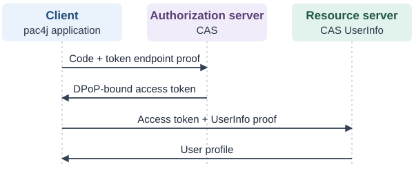

**Here is the problem:** These days, many applications use OpenID Connect to sign you in and an access token to call APIs on your behalf. If someone steals your JWT bearer access token, they can call the same APIs with the permissions it grants for as long as it remains valid. The issuer's signature still checks out on the stolen copy. Protection against that kind of reuse was long overdue.

**Here is the solution:** DPoP (*Demonstrating Proof of Possession*) binds the access token to the client's public key. To use the token, the client must sign a fresh proof with the corresponding private key. The API checks that the method and URI in the proof match the incoming request.


## 1) How does DPoP bind the token to the client?

Our pac4j v6.7.0 and Spring Boot application is the **Client**. CAS v8.1.0-RC3 is the **Authorization server** that issues the access token. CAS also acts as the **Resource server** when its UserInfo endpoint accepts that token and returns the user’s profile.

<p class="text-center">
  
</p>

When pac4j exchanges the authorization code for tokens, it signs a DPoP proof with its private key and includes the public key in the proof header. CAS puts the thumbprint of that key in the access token's `cnf.jkt` claim. See the specification ([RFC 9449](https://www.rfc-editor.org/rfc/rfc9449.html)) for the details of the key binding.

When pac4j calls UserInfo, its next proof includes `htm` (the HTTP method), `htu` (the target URI, excluding query and fragment) and `ath` (a hash of the access token). Those claims tie the proof to this call. The API must also check the access token's audience and permissions to establish that the **issuer** authorized the token for this resource and operation. We'll put those checks in context in part two.

**Why ask for a nonce?** The client chooses the timestamp (`iat`) in its proof. CAS can also send an unpredictable value of its own in the `DPoP-Nonce` header. When pac4j signs a new proof containing that value, CAS knows the proof was made after it issued the nonce. A proof prepared before that challenge cannot satisfy it. In production, pac4j authenticates the server by validating its TLS certificate and hostname over HTTPS. See [RFC 9449, section 11.2](https://www.rfc-editor.org/rfc/rfc9449.html#section-11.2) for the security rationale.


## 2) Follow the login flow

The application listens on port 8081 and CAS on port 8080. With `http://localhost:8080/cas/oidc` as the issuer (CAS), these are the endpoints to look for:

| Who calls whom | Request | What crosses the boundary |
|---|---|---|
| pac4j → CAS | `GET /.well-known/openid-configuration` under the issuer | pac4j discovers the authorization, token and UserInfo URLs. |
| Browser → CAS → pac4j | `GET /cas/oidc/oidcAuthorize`, then the pac4j `/callback` | The user signs in at CAS. The browser brings an authorization code back to pac4j. |
| pac4j → CAS | `POST /cas/oidc/oidcAccessToken` | pac4j exchanges the code and sends a signed JWT in the `DPoP` header. CAS issues an access token with `token_type=DPoP`. |
| pac4j → CAS | `GET /cas/oidc/oidcProfile` | pac4j calls UserInfo with `Authorization: DPoP <access token>` and a new `DPoP` proof. |

In this login flow, **pac4j signs two distinct DPoP proofs with the same private key**. The first is for the `POST` to the token endpoint, where pac4j exchanges the authorization code for an access token. The second is for the `GET` to UserInfo and includes `ath`, the hash of the access token CAS just issued. If CAS challenges a request with a nonce, pac4j signs a fresh proof for the retry.


## 3) Set up CAS and the pac4j client

You'll run two processes on the same machine. CAS runs in Tomcat on port 8080. The pac4j application runs its own embedded server on port 8081. Use a JDK 25, Maven, and a fresh Apache Tomcat 11 distribution. Set `JAVA_HOME` to the JDK and `CATALINA_HOME` to the unpacked Tomcat directory. The URLs below use plain HTTP on loopback for this local demo. Use HTTPS and signed ID tokens in a production deployment.

### 3.1) Build the CAS overlay

A CAS overlay is a small Maven project: Maven takes the CAS web application, adds the modules and configuration you choose, and produces a deployable WAR. You can create the overlay and the client side by side in an empty directory:

```bash
mkdir dpop-demo && cd dpop-demo
mkdir -p cas-overlay/src/main/resources/services
mkdir -p pac4j-app/src/main/java/org/pac4j/demos pac4j-app/src/main/resources
```

Save this as `cas-overlay/pom.xml`. The webapp supplies CAS itself, the OIDC module supplies the provider endpoints, and the JSON registry lets us register our pac4j client in a file.

```xml
<project xmlns="http://maven.apache.org/POM/4.0.0">
    <modelVersion>4.0.0</modelVersion>
    <groupId>org.pac4j.demo</groupId>
    <artifactId>cas-overlay</artifactId>
    <version>1.0</version>
    <packaging>war</packaging>

    <properties>
        <cas.version>8.1.0-RC3</cas.version>
    </properties>

    <dependencies>
        <dependency>
            <groupId>org.apereo.cas</groupId>
            <artifactId>cas-server-webapp</artifactId>
            <version>${cas.version}</version>
            <type>war</type>
            <scope>runtime</scope>
        </dependency>
        <dependency>
            <groupId>org.apereo.cas</groupId>
            <artifactId>cas-server-support-oidc</artifactId>
            <version>${cas.version}</version>
        </dependency>
        <dependency>
            <groupId>org.apereo.cas</groupId>
            <artifactId>cas-server-support-json-service-registry</artifactId>
            <version>${cas.version}</version>
        </dependency>
    </dependencies>

    <build>
        <finalName>cas</finalName>
        <plugins>
            <plugin>
                <groupId>org.apache.maven.plugins</groupId>
                <artifactId>maven-war-plugin</artifactId>
                <version>3.3.1</version>
                <configuration>
                    <failOnMissingWebXml>false</failOnMissingWebXml>
                    <archive>
                        <manifestFile>${project.build.directory}/war/work/org.apereo.cas/cas-server-webapp/META-INF/MANIFEST.MF</manifestFile>
                    </archive>
                    <overlays>
                        <overlay>
                            <groupId>org.apereo.cas</groupId>
                            <artifactId>cas-server-webapp</artifactId>
                        </overlay>
                    </overlays>
                </configuration>
            </plugin>
        </plugins>
    </build>
</project>
```

### 3.2) Configure the issuer and register the callback

Create `cas-overlay/src/main/resources/application.yml`. The issuer is the URL pac4j will discover. CAS generates its OIDC keystore in the writable Tomcat `temp` directory on first use. The static user and the cookie settings below are for the localhost login. Start with the DPoP nonce disabled so you can see the two proofs before introducing a retry.

```yaml
cas.server.name: http://localhost:8080
cas.server.prefix: http://localhost:8080/cas
cas.authn.oidc.core.issuer: http://localhost:8080/cas/oidc
cas.authn.oidc.jwks.file-system.jwks-file: file:${catalina.base}/temp/dpop-demo.jwks
cas.service-registry.json.location: classpath:/services
cas.authn.accept.users: jleleu::jleleu
cas.tgc.secure: false
cas.tgc.same-site-policy: Lax
cas.authn.oidc.dpop.nonce.enabled: false
```

Next, save the registration in `cas-overlay/src/main/resources/services/oidc-1.json`. The service URL pattern accepts any URL starting with `http://localhost:8081/callback`, including the callback with pac4j's `client_name` parameter. Use `localhost` consistently in both applications and in the browser.

```json
{
  "@class": "org.apereo.cas.services.OidcRegisteredService",
  "id": 1,
  "name": "pac4j DPoP demo",
  "clientId": "myclient",
  "clientSecret": "mysecret",
  "serviceId": "^http://localhost:8081/callback.*$",
  "bypassApprovalPrompt": true,
  "jwtAccessToken": true
}
```

`jwtAccessToken` tells CAS to issue an access token whose `cnf.jkt` we can inspect. The pac4j client uses the registered client secret to authenticate to CAS during the code exchange. In part two, the API uses the same demo credentials for token introspection.

### 3.3) Start CAS and check discovery

From `dpop-demo`, build the WAR and deploy it to the fresh Tomcat instance. Naming it `cas.war` gives it the `/cas` context path.

```bash
mvn -f cas-overlay/pom.xml clean package
cp cas-overlay/target/cas.war "$CATALINA_HOME/webapps/cas.war"
export CATALINA_OPTS="$CATALINA_OPTS -Dlogging.level.org.apereo.cas.support.oauth.validator=DEBUG"
"$CATALINA_HOME/bin/catalina.sh" run 2>&1 | tee -a cas.log
```

Leave Tomcat running. Open `http://localhost:8080/cas/oidc/.well-known/openid-configuration` in a browser. Before starting pac4j, check that the JSON contains `issuer` equal to `http://localhost:8080/cas/oidc`, and that `authorization_endpoint`, `token_endpoint` and `userinfo_endpoint` end in `/oidcAuthorize`, `/oidcAccessToken` and `/oidcProfile`. These are the addresses the client will actually call.

### 3.4) Create the Spring Boot application with pac4j

Start a second terminal in `dpop-demo`. Put this POM in `pac4j-app/pom.xml`:

```xml
<project xmlns="http://maven.apache.org/POM/4.0.0">
    <modelVersion>4.0.0</modelVersion>

    <parent>
        <groupId>org.springframework.boot</groupId>
        <artifactId>spring-boot-starter-parent</artifactId>
        <version>4.0.4</version>
        <relativePath/>
    </parent>

    <groupId>org.pac4j.demo</groupId>
    <artifactId>pac4j-app</artifactId>
    <version>1.0</version>

    <properties>
        <java.version>17</java.version>
        <pac4j.version>6.7.0</pac4j.version>
    </properties>

    <dependencies>
        <dependency>
            <groupId>org.springframework.boot</groupId>
            <artifactId>spring-boot-starter-web</artifactId>
        </dependency>
        <dependency>
            <groupId>org.pac4j</groupId>
            <artifactId>spring-webmvc-pac4j</artifactId>
            <version>8.0.4</version>
        </dependency>
        <dependency>
            <groupId>org.pac4j</groupId>
            <artifactId>pac4j-oidc</artifactId>
            <version>${pac4j.version}</version>
        </dependency>
        <dependency>
            <groupId>org.pac4j</groupId>
            <artifactId>pac4j-dpop</artifactId>
            <version>${pac4j.version}</version>
        </dependency>
    </dependencies>

    <build>
        <plugins>
            <plugin>
                <groupId>org.springframework.boot</groupId>
                <artifactId>spring-boot-maven-plugin</artifactId>
            </plugin>
        </plugins>
    </build>
</project>
```

In `pac4j-app/src/main/resources/application.properties`, choose the port registered with CAS and enable the two protocol loggers:

```properties
server.port=8081
logging.level.PROTOCOL_MESSAGE.OIDC=DEBUG
logging.level.PROTOCOL_MESSAGE.DPOP=DEBUG
```

Place the following two Java files in `pac4j-app/src/main/java/org/pac4j/demos/`. First, `SpringBootDemo.java` starts the application and provides a public link and a protected page. The protected page displays the subject that pac4j obtained at login.

```java
package org.pac4j.demos;

import org.pac4j.core.profile.ProfileManager;
import org.springframework.beans.factory.annotation.Autowired;
import org.springframework.boot.SpringApplication;
import org.springframework.boot.autoconfigure.SpringBootApplication;
import org.springframework.web.bind.annotation.GetMapping;
import org.springframework.web.bind.annotation.RestController;

@SpringBootApplication
@RestController
public class SpringBootDemo {
    public static void main(String[] args) {
        SpringApplication.run(SpringBootDemo.class, args);
    }

    @Autowired
    private ProfileManager profiles;

    @GetMapping(value = "/", produces = "text/html")
    public String home() {
        return "<a href='/protected/index'>Protected area</a>";
    }

    @GetMapping(value = "/protected/index", produces = "text/plain")
    public String protectedPage() {
        return "Signed in as " + profiles.getProfile().orElseThrow().getId();
    }
}
```

Then create `SecurityConfig.java`. The discovery URI and client ID match CAS. In this local setup, the CAS discovery document lists `none` among the ID token signing algorithms. pac4j only accepts such a provider when unsigned ID tokens are explicitly allowed, so the demo client sets `config.setAllowUnsignedIdTokens(true)`. The line that enables DPoP for the access token is `config.setHttpInterceptor(new DPoPHttpInterceptor())`. `Pac4jSecurityConfig` supplies the callback controller, and mapping `/protected/**` to `OidcClient` starts login when the browser opens the protected page.

```java
package org.pac4j.demos;

import org.pac4j.core.config.Config;
import org.pac4j.dpop.http.DPoPHttpInterceptor;
import org.pac4j.oidc.client.OidcClient;
import org.pac4j.oidc.config.OidcConfiguration;
import org.pac4j.springframework.config.Pac4jSecurityConfig;
import org.springframework.context.annotation.Bean;
import org.springframework.context.annotation.Configuration;
import org.springframework.web.servlet.config.annotation.InterceptorRegistry;

@Configuration
public class SecurityConfig extends Pac4jSecurityConfig {
    @Bean
    public OidcConfiguration oidcConfiguration() {
        var config = new OidcConfiguration();
        config.setDiscoveryURI("http://localhost:8080/cas/oidc/.well-known/openid-configuration");
        config.setClientId("myclient");
        config.setSecret("mysecret");
        config.setAllowUnsignedIdTokens(true);
        config.setHttpInterceptor(new DPoPHttpInterceptor());
        return config;
    }

    @Bean
    public Config config() {
        return new Config("http://localhost:8081/callback", new OidcClient(oidcConfiguration()));
    }

    @Override
    public void addInterceptors(InterceptorRegistry registry) {
        addSecurity(registry, "OidcClient").addPathPatterns("/protected/**");
    }
}
```

### 3.5) Start the client and sign in

From `dpop-demo`, start the client and save its console output:

```bash
mvn -f pac4j-app/pom.xml spring-boot:run 2>&1 | tee -a pac4j.log
```

Before signing in, open a third terminal in `dpop-demo` and follow both logs. The filename above each group of lines tells you which side produced it.

```bash
tail -n 0 -F pac4j.log cas.log
```

Open `http://localhost:8081/` and click **Protected area**. The browser should go to CAS on port 8080. Sign in as `jleleu` with password `jleleu`. After the callback on port 8081, the protected page should show `Signed in as jleleu`. The browser has followed the redirects; pac4j has exchanged the code and called UserInfo using the same session key for both proofs.


## 4) What happens with and without a CAS nonce?

The two DEBUG loggers configured above show the proofs and the HTTP exchange together. To see the decoded claims, add `logging.level.org.pac4j.dpop.http.DPoPHttpInterceptor=TRACE` to the client properties and restart the client. In the excerpts below, each compact JWT is shown with its first and last four characters.

### 4.1) First login, nonce disabled

In a fresh browser session, open `http://localhost:8081`, select **Protected area**, and sign in with a local demo account such as `jleleu` / `jleleu`. Follow the code exchange and the subsequent UserInfo request. CAS can bind the token and verify both proofs on the first attempt.

**pac4j client — outgoing proofs and CAS responses.** The two `PROTOCOL_MESSAGE.DPOP` lines show which proof pac4j sends with each request.

```text
DEBUG PROTOCOL_MESSAGE.DPOP : >>> server POST http://localhost:8080/cas/oidc/oidcAccessToken DPoP: eyJ0...wU6Q
DEBUG PROTOCOL_MESSAGE.OIDC : <<< OpenID provider 200 { "access_token" : "eyJh...AgVQ", "id_token" : "eyJh...bDVw", "token_type" : "DPoP", "expires_in" : 28800, "scope" : "openid profile email" }
DEBUG PROTOCOL_MESSAGE.DPOP : >>> server GET http://localhost:8080/cas/oidc/oidcProfile DPoP: eyJ0...pxCA
DEBUG PROTOCOL_MESSAGE.OIDC : <<< OpenID provider 200 {"sub":"jleleu","service":"http://localhost:8081/callback?client_name=OidcClient","auth_time":1795702226,"attributes":{},"id":"jleleu","client_id":"myclient"}
```

**Decoded access token (`eyJh...AgVQ`).** The header identifies the signing algorithm and the CAS key used to sign this token.

```json
{
  "alg": "RS512",
  "typ": "JWT",
  "kid": "cas-XatPGtrt",
  "org.apereo.cas.services.RegisteredService": "1"
}
```

The payload shows who signed in (`sub`) and which client the token is intended for (`aud`). In this CAS response, the `DPoP` claim also contains the proof pac4j sent to the token endpoint. The proof and the CAS ticket identifier (`jti`) are abbreviated below.

```json
{
  "aud": "myclient",
  "sub": "jleleu",
  "DPoPConfirmation": "upnnpYewXYFxofBT-dhSFc2y8yMaXtqe1OyBHBxjKWM",
  "grant_type": "authorization_code",
  "iss": "http://localhost:8080/cas/oidc",
  "response_type": "none",
  "cnf": {
    "jkt": "upnnpYewXYFxofBT-dhSFc2y8yMaXtqe1OyBHBxjKWM"
  },
  "exp": 1795731027,
  "iat": 1795702227,
  "DPoP": "eyJ0...wU6Q",
  "jti": "AT-1...mac3",
  "client_id": "myclient"
}
```

The access token’s `cnf.jkt` matches the thumbprint of the client’s public key, shown in the shared proof header below. With the CAS nonce disabled, neither DPoP proof contains a `nonce` claim.

**Decoded header shared by both proofs.** The `jwk` is the public key CAS uses to verify their ES256 signatures.

```json
{
  "typ": "dpop+jwt",
  "alg": "ES256",
  "jwk": {
    "kty": "EC",
    "use": "sig",
    "crv": "P-256",
    "x": "7ow2sqz6GTci23HQpXFnsa2sE_IWyzhKRs6cFURb_2s",
    "y": "hNoc5tMCbZIzs1aqqNqPPeHHxVcx4mJjoSxidDrk1oY",
    "alg": "ES256"
  }
}
```

**Proof 1 — token endpoint (`eyJ0...wU6Q`).** pac4j is asking CAS for an access token. The payload identifies the request by its HTTP method (`htm`) and target URI (`htu`).

```json
{
  "htm": "POST",
  "htu": "http://localhost:8080/cas/oidc/oidcAccessToken",
  "iat": 1795702227,
  "jti": "BvaIQFupCAm8b05L"
}
```

**Proof 2 — UserInfo endpoint (`eyJ0...pxCA`).** After receiving the access token, pac4j signs a fresh proof for the GET request. Its `ath` is the base64url-encoded SHA-256 hash of the access token `eyJh...AgVQ`.

```json
{
  "htm": "GET",
  "htu": "http://localhost:8080/cas/oidc/oidcProfile",
  "ath": "F1krHm3qvyzD-XLMb7Hs_cHlGU-q4Mxiez85UFqAkYQ",
  "iat": 1795702227,
  "jti": "TDT3N22_6n__-m13"
}
```

Both proofs were issued in the same second (`iat`), but each has its own identifier (`jti`).

**CAS server — token issuance and UserInfo proof verification.** The CAS protocol log records the token type and status. The validator then names the client and the exact URL it checks for the second proof.

```text
INFO [PROTOCOL_MESSAGE]
OAuth/OpenID Connect Token Response
access_token: eyJh...AgVQ
scope: openid profile email
expires_in: 28800
token_type: DPoP
id_token: eyJh...bDVw
status: 200 OK
…
DEBUG [org.apereo.cas.support.oauth.validator.DefaultOAuth20ProofOfPossessionValidator] - <Verifying DPoP proof for client [myclient] at [http://localhost:8080/cas/oidc/oidcProfile]>
```

### 4.2) Second login, nonce enabled

Change the CAS setting to `cas.authn.oidc.dpop.nonce.enabled: true`. Stop Tomcat, rebuild and copy the WAR as in section 3, then restart Tomcat and sign in again in a fresh browser session.

**pac4j client — one challenge, one retry.** The first POST gets HTTP 400 and `use_dpop_nonce`. CAS supplies its nonce in the `DPoP-Nonce` response header. Look for **Resending HTTP request**: pac4j sends the same authorization code and PKCE verifier a second time, with a freshly signed proof. This POST gets HTTP 200.

```text
DEBUG PROTOCOL_MESSAGE.DPOP : >>> server POST http://localhost:8080/cas/oidc/oidcAccessToken DPoP: eyJ0...aEqA
DEBUG PROTOCOL_MESSAGE.OIDC : >>> OpenID provider POST http://localhost:8080/cas/oidc/oidcAccessToken grant_type=authorization_code&code=<code>&redirect_uri=<callback>&code_verifier=<code-verifier>
DEBUG PROTOCOL_MESSAGE.OIDC : <<< OpenID provider 400 {   "error" : "use_dpop_nonce",   "error_description" : "DPoP proof carries no valid server-provided nonce" }
DEBUG PROTOCOL_MESSAGE.DPOP : <<< server http://localhost:8080 DPoP-Nonce: TST-...mac3 (use_dpop_nonce)
DEBUG PROTOCOL_MESSAGE.DPOP : >>> server POST http://localhost:8080/cas/oidc/oidcAccessToken DPoP: eyJ0...3afg
DEBUG PROTOCOL_MESSAGE.OIDC : >>> OpenID provider Resending HTTP request
DEBUG PROTOCOL_MESSAGE.OIDC : >>> OpenID provider POST http://localhost:8080/cas/oidc/oidcAccessToken grant_type=authorization_code&code=<code>&redirect_uri=<callback>&code_verifier=<code-verifier>
DEBUG PROTOCOL_MESSAGE.OIDC : <<< OpenID provider 200 {"access_token": "eyJh...DNug", "id_token": "eyJh...LX-w", "token_type": "DPoP", "expires_in": 28800, "scope": "openid profile email"}
DEBUG PROTOCOL_MESSAGE.DPOP : >>> server GET http://localhost:8080/cas/oidc/oidcProfile DPoP: eyJ0...z0HA
DEBUG PROTOCOL_MESSAGE.OIDC : >>> OpenID provider GET http://localhost:8080/cas/oidc/oidcProfile
DEBUG PROTOCOL_MESSAGE.OIDC : <<< OpenID provider 200 {"sub": "jleleu", "service": "http://localhost:8081/callback?client_name=OidcClient", "auth_time": 1795703215, "attributes": {}, "id": "jleleu", "client_id": "myclient"}
```

**Decoded access token (`eyJh...DNug`, selected claims).** The CAS `DPoP` claim contains the proof from the successful second POST (`eyJ0...3afg`). The `cnf.jkt` value matches the thumbprint of the public key that pac4j used for all three proofs in this login.

```json
{
  "cnf": {
    "jkt": "VVlgzXhm6bydhiQc7Su5zH9PmoMOrJ7BKazl5Qgx7eY"
  },
  "DPoP": "eyJ0...3afg"
}
```

**1. First POST — before the challenge (`eyJ0...aEqA`).** There is no `nonce` claim. CAS responds with the nonce `TST-...mac3` (abbreviated consistently below).

```json
{
  "htm": "POST",
  "htu": "http://localhost:8080/cas/oidc/oidcAccessToken",
  "iat": 1795703216,
  "jti": "F8ERsB7wcpSAeupJ"
}
```

**2. Retried POST — after the challenge (`eyJ0...3afg`).** Compare `htm` and `htu` with the first proof: the request still targets the same token endpoint. The new `nonce` claim contains exactly the value from the response header, and `jti` changes from `F8ERsB7wcpSAeupJ` to `IeibeWxHVtRLH6Yu`.

```json
{
  "htm": "POST",
  "htu": "http://localhost:8080/cas/oidc/oidcAccessToken",
  "iat": 1795703216,
  "nonce": "TST-...mac3",
  "jti": "IeibeWxHVtRLH6Yu"
}
```

**3. GET UserInfo (`eyJ0...z0HA`).** In this run pac4j sends the same CAS nonce on the first UserInfo call. This proof has a third `jti`, names the UserInfo endpoint and includes `ath`, the hash of the access token just issued. CAS returns the profile for `jleleu` on the first attempt.

```json
{
  "htm": "GET",
  "htu": "http://localhost:8080/cas/oidc/oidcProfile",
  "ath": "hI0ONYNlc3SU2Y_Zz8pPIa-65mFb3sc9tMDCMlEXnOU",
  "iat": 1795703216,
  "nonce": "TST-...mac3",
  "jti": "5yB7Lc_HaQ5ijCUr"
}
```

**CAS server — challenge, token issuance and UserInfo verification.** CAS logs why it challenged the first POST, then records a successful DPoP token response for the retry.

```text
INFO [org.apereo.cas.support.oauth.web.endpoints.OAuth20AccessTokenEndpointController] - <DPoP proof of the access token request carries no valid nonce; a fresh nonce is provided>
INFO [PROTOCOL_MESSAGE] - <
OAuth/OpenID Connect Token Response
…
token_type: DPoP
…
status: 200 OK
…
DEBUG [org.apereo.cas.support.oauth.validator.DefaultOAuth20ProofOfPossessionValidator] - <Verifying DPoP proof for client [myclient] at [http://localhost:8080/cas/oidc/oidcProfile]>
```

## 5) Conclusion

The useful checkpoint is the UserInfo call. CAS has issued a token bound to the pac4j client's key, and pac4j has used that same key to sign a different proof for a different endpoint. Turning on the CAS nonce adds a challenge and one retry to the first exchange. The controller code stays the same.

<div class="text-center highlight-blog">With pac4j and DPoP, your OIDC client protects you against token theft.</div>

In part two, we'll keep this login and send the token to our **own** API...
