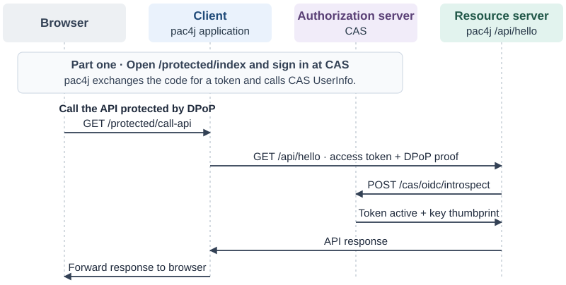

This article is the server-side companion to [DPoP in action with pac4j (1/2): client support](/blog/dpop_in_action_client_support.html). In part one, our pac4j client signed a DPoP proof to call the CAS UserInfo endpoint. In this article, we will add an API to the same pac4j v6.7.0 application and protect it with `DirectDPoPAuthClient`, to verify the DPoP proof on each API call.

**Here is the problem:** Someone who steals an access token can use it to call our API as the user if the API only checks that the token is active.

**Here is the solution:** DPoP (*Demonstrating Proof of Possession*) binds the access token to the client’s public key. For each call to `GET /api/hello`, our pac4j API checks that the DPoP proof was signed for that request with the corresponding private key. Someone who steals only the token cannot produce that proof.


## 1) What does the API need to know?

As in part one, CAS v8.1.0-RC3 is the **Authorization server** that issued the access token. For this API call, the pac4j application plays two roles. Its `callApi()` controller is the **Client** that sends the request. Its `/api/hello` endpoint is the **Resource server** that receives it.

<p class="text-center">
  
</p>

As the resource server, our API makes two checks on each call.

1. **Verify the DPoP proof for this request.** The API checks the signature, the HTTP method (`htm`) and the target URI (`htu`). A proof signed for CAS UserInfo cannot be reused for `GET /api/hello`.
2. **Check the access token with CAS.** The API asks CAS whether the token is active, then compares the key thumbprint returned by CAS (`cnf.jkt`) with the thumbprint of the public key in the proof.

In a deployment with several APIs, each must also check its expected audience and the permissions for the operation. A caller can choose which URL to sign, but only the issuer can grant access to it.


## 2) Follow the API flow

Start in a fresh browser session and open `/protected/index`. As in part one, you sign in at CAS. Then pac4j exchanges the authorization code for a DPoP-bound access token and calls CAS UserInfo. Back on the protected page, you now see a **Call the API protected by DPoP** link. Its controller and the API both run in the same pac4j application on port 8081.

1. **Browser → application controller.** When you click the link, the browser requests `GET /protected/call-api` with its session cookie. The `callApi()` controller reuses the access token already stored in the user's OIDC profile.
2. **Application controller → protected API.** On the server, `callApi()` makes a separate HTTP request to `GET /api/hello`. pac4j uses the private key in the user's session to sign a proof for that request. The API receives the access token and the proof.
3. **Protected API → CAS.** Once `DirectDPoPAuthClient` verifies the proof, the API sends the access token to `POST /cas/oidc/introspect`. It checks that CAS reports an active token bound to the key used for the proof.

On success, `/api/hello` returns its JSON to `callApi()`, which forwards the HTTP status and body to the browser. You see the API’s response while the address bar still shows `/protected/call-api`.


## 3) Protect the API and validate its token with CAS

Start with the working demo from part one. Keep CAS running with the same service registration. All the changes below are in `pac4j-app`; its existing POM already contains the required modules.

### 3.1) Register the API client

In `SecurityConfig.config()`, add a `DirectDPoPAuthClient` alongside the existing OIDC client. Use the introspection URL of the same CAS issuer and the credentials from `oidc-1.json`.

In part one, CAS issued and checked a nonce for its own endpoints. Here, we enable the same optional check on `GET /api/hello`. **The API issues its own nonce so it can verify that the client signed the proof after the API issued its challenge.** On the retry, the API verifies the signature and checks that the proof’s `nonce` claim contains a value it recently issued.

```java
var apiClient = new DirectDPoPAuthClient(new IntrospectionAuthenticator(
    "http://localhost:8080/cas/oidc/introspect", "myclient", "mysecret"));
apiClient.setCredentialsExtractor(new DPoPAuthExtractor()
    .setNonceSecret("demo-api-secret"));

return new Config("http://localhost:8081/callback", new OidcClient(oidcConfiguration()), apiClient);
```

For this local demo, `demo-api-secret` is the fixed key the API uses to generate and verify time-limited nonces. The client receives the generated value in the `DPoP-Nonce` response header and includes that value in its next signed proof.

Import `org.pac4j.dpop.client.direct.DirectDPoPAuthClient` and `org.pac4j.dpop.credentials.extractor.DPoPAuthExtractor`. In `addInterceptors()`, add one mapping after the existing `/protected/**` mapping:

```java
addSecurity(registry, "DirectDPoPAuthClient").addPathPatterns("/api/**");
```

### 3.2) Add the link and its handler

In `SpringBootDemo`, change the protected page to return HTML so the signed-in user can click through:

```java
@GetMapping(value = "/protected/index", produces = "text/html")
public String protectedPage() {
    return "<a href='/protected/call-api'>Call the API protected by DPoP</a>";
}
```

Add the following fields and methods to the same controller. Reuse its `profiles` field and the `OidcConfiguration` bean from part one. In `callApi()`, the `oidcConfiguration.send(...)` line makes the server-side HTTP call. The `hello()` method handles it after pac4j authenticates the request.

```java
@Autowired private OidcConfiguration oidcConfiguration;
@Autowired private WebContext webContext;
@Autowired private SessionStore sessionStore;

@GetMapping("/protected/call-api")
public ResponseEntity<String> callApi() throws IOException {
    var token = profiles.getProfile(OidcProfile.class).orElseThrow().getAccessToken();
    var request = new HTTPRequest(HTTPRequest.Method.GET, URI.create("http://localhost:8081/api/hello"));
    request.setAuthorization(token.toAuthorizationHeader());
    var response = oidcConfiguration.send(request, new CallContext(webContext, sessionStore));
    return ResponseEntity.status(response.getStatusCode()).body(response.getBody());
}

@GetMapping("/api/hello")
public Map<String, String> hello() {
    var profile = profiles.getProfile().orElseThrow();
    return Map.of("hello", profile.getId(), "authenticatedBy", profile.getClientName());
}
```

These additions use Nimbus `com.nimbusds.oauth2.sdk.http.HTTPRequest`, pac4j's `CallContext`, `WebContext`, `SessionStore`, `OidcConfiguration` and `OidcProfile`, Spring's `ResponseEntity`, and the JDK types `IOException`, `URI` and `Map`.

### 3.3) Validate on the receiving side

`DPoPAuthExtractor` checks the proof signature, HTTP method, target URI, issue time and single-use identifier. It checks `ath` against the presented access token and compares the signing key with the token's `cnf.jkt`. At this point the thumbprint read from the JWT is still a claim awaiting confirmation by the issuer.

That is the job of `IntrospectionAuthenticator`. It authenticates the API to CAS with HTTP Basic client credentials and sends the **access token** to `/cas/oidc/introspect`. It requires an active response and compares the thumbprint from the token with the one CAS returned. On success it sets the profile ID from the introspected subject. The demo checks activity and key binding here; an API with a specific audience or required scope must enforce those conditions before accepting the profile.

Save the following class as `pac4j-app/src/main/java/org/pac4j/demos/IntrospectionAuthenticator.java`.

```java
package org.pac4j.demos;

import com.nimbusds.jwt.JWTParser;
import com.nimbusds.oauth2.sdk.TokenIntrospectionRequest;
import com.nimbusds.oauth2.sdk.TokenIntrospectionResponse;
import com.nimbusds.oauth2.sdk.TokenIntrospectionSuccessResponse;
import com.nimbusds.oauth2.sdk.auth.ClientSecretBasic;
import com.nimbusds.oauth2.sdk.auth.Secret;
import com.nimbusds.oauth2.sdk.dpop.JWKThumbprintConfirmation;
import com.nimbusds.oauth2.sdk.id.ClientID;
import com.nimbusds.oauth2.sdk.token.DPoPAccessToken;
import org.pac4j.core.context.CallContext;
import org.pac4j.core.credentials.Credentials;
import org.pac4j.core.credentials.TokenCredentials;
import org.pac4j.core.credentials.authenticator.Authenticator;
import org.pac4j.core.exception.CredentialsException;
import org.pac4j.core.exception.TechnicalException;
import org.pac4j.core.profile.CommonProfile;

import java.io.IOException;
import java.net.URI;
import java.text.ParseException;
import java.util.Optional;

/**
 * Validates an access token by asking the authorization server which issued it, at its introspection endpoint (RFC 7662).
 */
public class IntrospectionAuthenticator implements Authenticator {

    private final URI introspectionEndpoint;

    private final ClientSecretBasic clientAuthentication;

    public IntrospectionAuthenticator(final String introspectionEndpoint, final String clientId, final String secret) {
        this.introspectionEndpoint = URI.create(introspectionEndpoint);
        this.clientAuthentication = new ClientSecretBasic(new ClientID(clientId), new Secret(secret));
    }

    @Override
    public Optional<Credentials> validate(final CallContext ctx, final Credentials credentials) {
        final var accessToken = ((TokenCredentials) credentials).getToken();
        final var introspection = introspect(accessToken);
        if (!introspection.isActive()) {
            throw new CredentialsException("The access token is not active");
        }
        // the DPoP proof has been checked against the key carried by the access token ("cnf" claim of the JWT):
        // it must be the key the authorization server has bound this access token to (RFC 9449, section 6.2)
        if (!retrieveConfirmation(accessToken).equals(introspection.getJWKThumbprintConfirmation())) {
            throw new CredentialsException("The access token is not bound to the key it carries");
        }

        final var profile = new CommonProfile();
        profile.setId(introspection.getSubject().getValue());
        profile.addAttributes(introspection.toJSONObject());
        credentials.setUserProfile(profile);
        return Optional.of(credentials);
    }

    private TokenIntrospectionSuccessResponse introspect(final String accessToken) {
        final var request = new TokenIntrospectionRequest(introspectionEndpoint, clientAuthentication, new DPoPAccessToken(accessToken));
        try {
            final var response = TokenIntrospectionResponse.parse(request.toHTTPRequest().send());
            if (!response.indicatesSuccess()) {
                throw new TechnicalException("Introspection refused: " + response.toErrorResponse().getErrorObject());
            }
            return response.toSuccessResponse();
        } catch (final IOException | com.nimbusds.oauth2.sdk.ParseException e) {
            throw new TechnicalException("Cannot introspect the access token", e);
        }
    }

    private JWKThumbprintConfirmation retrieveConfirmation(final String accessToken) {
        try {
            return JWKThumbprintConfirmation.parse(JWTParser.parse(accessToken).getJWTClaimsSet());
        } catch (final ParseException e) {
            throw new CredentialsException("The access token is not a JWT", e);
        }
    }
}
```

Restart the pac4j application. CAS already has everything it needs to answer the introspection request.


## 4) What happens when we click “Call the API protected by DPoP”?

Sign in as in part one and click **Call the API protected by DPoP** for the first time in that session. Keep the pac4j protocol loggers from part one. To see the receiving side in the same console, also enable `logging.level.org.pac4j.dpop.credentials.extractor.DPoPAuthExtractor=DEBUG`. Use the CAS log for the introspection call.

1. **The API asks for its own nonce.** The extractor has a nonce secret. On the first call without a valid API nonce, the API returns HTTP 401 with a `WWW-Authenticate: DPoP` challenge carrying `use_dpop_nonce` and a `DPoP-Nonce` response header. CAS has received no introspection request for this attempt. The challenge comes from the API on port 8081, independently of the CAS nonce setting on port 8080.
2. **The client repeats the GET once.** The interceptor uses the API nonce in a fresh proof. The key, access token, method and target URI stay the same. The proof identifier changes. Look for `Resending HTTP request` on the calling side and the proof-validation message on the receiving side.
3. **The API asks CAS about the token.** After the proof passes, the authenticator sends the introspection POST. If CAS confirms activity and the matching key, `/api/hello` returns HTTP 200. On the result page, look for the subject in `hello` and `DirectDPoPAuthClient` in `authenticatedBy`.

**pac4j client — the GET and its retry.** The `OpenID provider` prefix comes from the OIDC client logger. Both GETs here target our own API on port 8081.

```text
DEBUG PROTOCOL_MESSAGE.DPOP : >>> server GET http://localhost:8081/api/hello DPoP: eyJ0...Rl7g
DEBUG PROTOCOL_MESSAGE.OIDC : <<< OpenID provider 401 …
DEBUG PROTOCOL_MESSAGE.DPOP : <<< server http://localhost:8081 DPoP-Nonce: MTc5...OFJr (use_dpop_nonce)
DEBUG PROTOCOL_MESSAGE.DPOP : >>> server GET http://localhost:8081/api/hello DPoP: eyJ0...jFxw
DEBUG PROTOCOL_MESSAGE.OIDC : >>> OpenID provider Resending HTTP request
DEBUG PROTOCOL_MESSAGE.OIDC : <<< OpenID provider 200 {"authenticatedBy":"DirectDPoPAuthClient","hello":"jleleu"}
```

**pac4j API — issuing the nonce and validating the proof.** These lines are written by the API. Read `<<< client` as “received from the client” and `>>> client` as “sent to the client”.

```text
DEBUG PROTOCOL_MESSAGE.DPOP : <<< client GET http://localhost:8081/api/hello DPoP proof received
DEBUG PROTOCOL_MESSAGE.DPOP : >>> client DPoP-Nonce: MTc5...OFJr (use_dpop_nonce)
INFO o.p.d.c.direct.DirectDPoPAuthClient : Failed to retrieve credentials: A valid nonce is required in the DPoP proof
DEBUG PROTOCOL_MESSAGE.DPOP : <<< client GET http://localhost:8081/api/hello DPoP proof received
DEBUG o.p.d.c.extractor.DPoPAuthExtractor : DPoP proof validated for method GET with algorithm ES256
```

The `Failed to retrieve credentials` line belongs to the **first GET**. The client sent its access token and a signed proof, but the proof contained no API nonce. pac4j therefore stopped before token introspection and returned HTTP 401 with the nonce to use. The final `DPoP proof validated` line belongs to the **second GET**, when the client signed a new proof containing that nonce.

| Claim | First GET (`eyJ0...Rl7g`) | Retried GET (`eyJ0...jFxw`) |
|---|---|---|
| `jti` | `ZTMvctuXxVB2-C7M` | `Fca70GT0mZDYReJi` |
| `nonce` | Absent | `MTc5...OFJr` |
| `ath` | `pkuCBSG6jd9ZI_WQx-XEHdu5Gl4b77IjEvn1_leomlI` | `pkuCBSG6jd9ZI_WQx-XEHdu5Gl4b77IjEvn1_leomlI` |

The retry uses a new proof identifier and includes the API’s nonce. Both proofs target `GET /api/hello` and carry the same `ath`, the hash of the access token.

**CAS — token introspection.** After the API validates the second proof, it sends the access token to `POST /cas/oidc/introspect`. CAS records the request from `myclient`:

```text
INFO [PROTOCOL_MESSAGE]
OpenID Connect Introspection Request
Token: eyJh...iqbQ
Client ID: myclient
Service: pac4j DPoP demo
```

CAS returned HTTP 200. Its protocol log shows the request. On the API side, the successful response for `jleleu` confirms that the authenticator received an active token with a matching key thumbprint.

## 5) Conclusion

The two posts meet at the call to `/api/hello`. The OIDC client still holds the private key it used during login. The API can verify that the caller holds it now, that the proof covers this particular GET, and that CAS recognizes the token and the same key. Those checks let the controller answer a request made on the user's behalf without receiving the browser's session cookie.

<div class="text-center highlight-blog">With pac4j and DPoP, a stolen access token alone won’t get an attacker into your API.</div>
